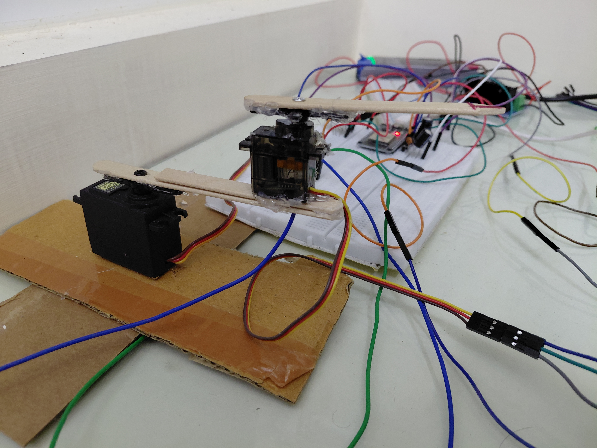
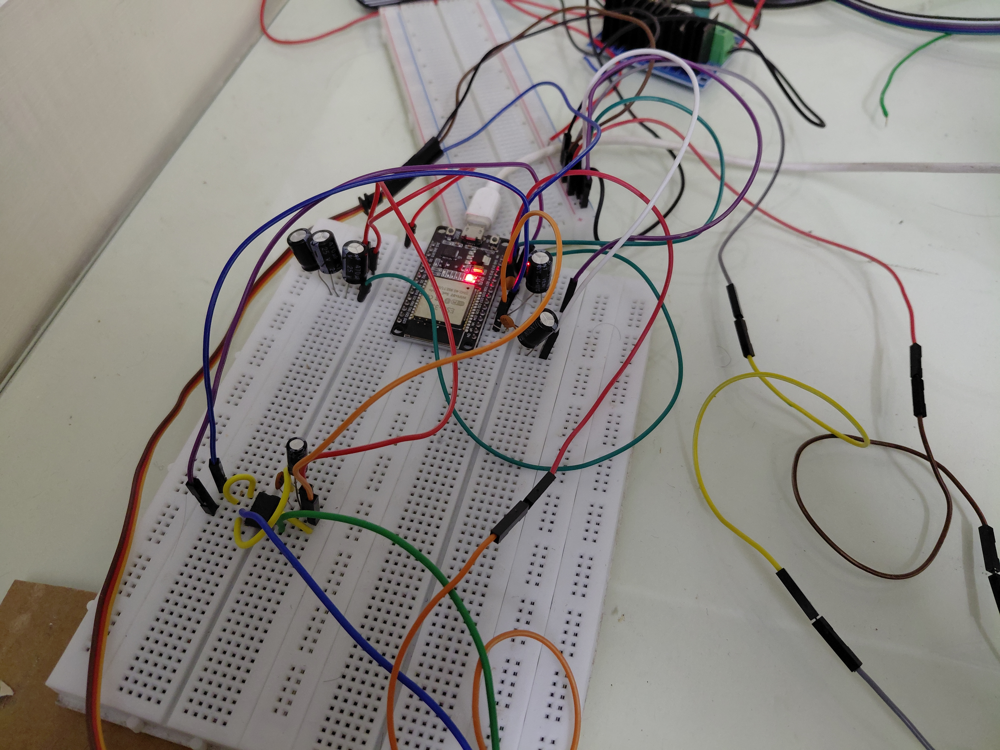
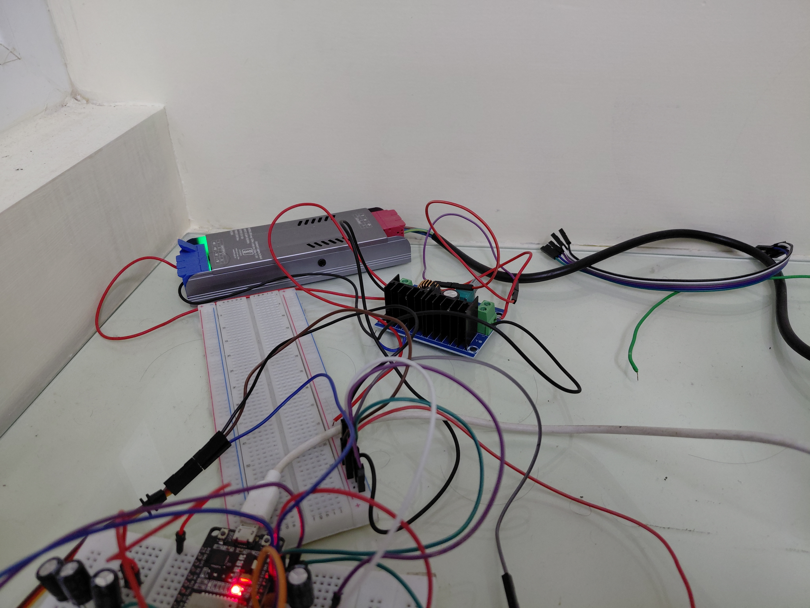
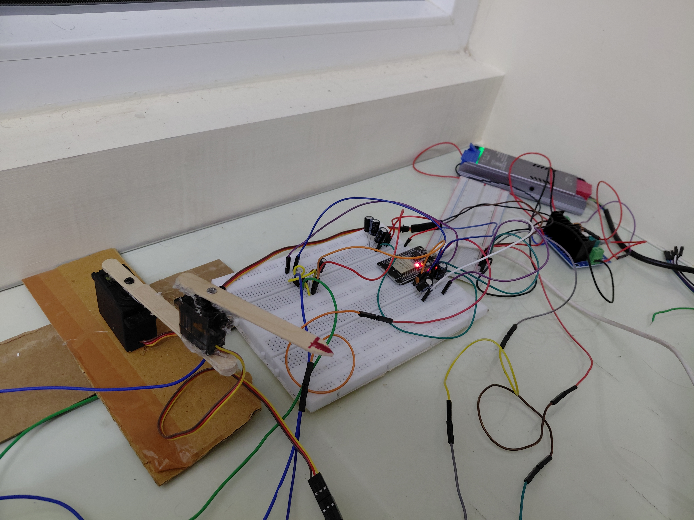

## Description
Simple ESP32 code for a 2DOF arm made using ice-cream sticks and 2 servo motors

## Motivation
This is essentially my first sojourn into the world of robotics. I was waiting for a 5DOF 3D-printed arm that I ordered online, but figured that there might be a lot to learn even from
a simple 2 DOF arm construction. 

Initially this started as an attempt to make a robot with a pen on its end effector to draw things, but the mechanics for the "holding the pen and applying appropriate pressure" part
turned out to be a bit of a hassle, so I decided against it.

## Scope
The only things I wanted to get done here were:

    1. **Bluetooth** connectivity between my Laptop and the ESP32.
    2. Real time **tracking of the arm's position** using a wire soldered to the internal potentiometers of the servos.
    3. Using the data from point 2, create a basic **Digital Twin** of the arm.
    3. **Moving the servos** using remote commands via BT
    4. **Inverse Kinematics** for the arm. Not done in this release, but will be included in the next one.
    5. (**Maybe**) Getting the arm to follow a certain **trajectory**. This I still need to look into.

## Software Requirement
- This has been tested only on Linux, so not sure about how it should be built and flashed in Windows
- ESP-IDF development environment

## Build instructions
For the client:
```sh
cd bt_client
make
```

For the server(after making sure that the ESP32 is connected):
```sh
cd bt_server
idf.py -p [YOUR_ESP_PORT] flash monitor
```

## Progress
- You can connect to the ESP32 via a Linux system and send commands to set servo angles
- You can view the arm's position on the client in real-time
- You can now calculate servo angles given end-effector position. 

- Have to implement bounds checking for IK

## Setup
The electronics shall be explained later, in more detail. This is what the setup LOOKS like though








## Videos of the working arm
1. Setting Servo Angles:

https://github.com/user-attachments/assets/f188709f-138d-4c69-847a-8c98933a1f3a

2. Arm movement with position shown in the client:

https://github.com/user-attachments/assets/7eef4c33-fd19-4130-acd1-c42e1eefb253

3. Inverse Kinematics, bounds and all:

## Circuit Schematic
TODO

## Development Notes
### First Release
I ran into a couple of issues in the first release, which I have touched upon here.
- Measuring the servo's position via a wire to the internal potentiometer appeared to be fine in isolation, but when I had to apply voltage to also MOVE the servos while it was being
  measured, this caused the servos to start malfunctioning. Likely this is because the ESP32's ADC does not tolerate the impedance of the internal pot, leading to current draw. My 
  solution to this was to add a simple op-amp buffer, which fixed it. Ideally though, I am aware, I ought to use a specialized ADC.
- Another electronics problem was a brownout being triggered by the usage of the BT stack in the ESP32. This was simply because of current spikes due to the stack, and was fixed by
  adding 3 470uF capacitors in parallel(with equivalent capacitance 3\*470 = 1410uF) to the GND and 3.3V pins, which regulated the spikes.
- The wathcdog timer for CPU0, which runs the bluetooth stack, kept getting tripped. I initially thought it was because of some other task than BT running in CPU0, but pinning my 2 
  tasks to CPU1 didn't seem to work. Then, I tried lowering the priorities of my tasks, `BtAdcSendTask` and `ServoMoveTask`, which seemed to fix the issue.
- The `adc_oneshot_read` also started tripping the watchdog timer(and to some extent this issue is still there) so I just added a delay of 10 ms that runs for every 16 reads
  (see `transmit_task` in `main.c`)
- I initially had a more complicated design for the arm with trusses and stuff, but I discarded this design as my scope changed(as mentioned in the `Motivation` section).
- I looked at a few algorithms for filtering the noisy ADC(exponential average, a median filter) for the servo positions, as it was really quite variable but settled on a simple mean
  due to the complexity of the other approaches.
### Working towards the Second Release
- I wanted to get the displaying arm position stuff done for this, but noticed that the angles shown and the actual angle the arm was at were really disimilar(off by 5-10 degrees).
  Turns out, the upper and lower bounds I set for the `convert_voltage_to_angle` function in the client are not the true ones(each servo has a different upper and lower bound). So I
  added 2 functions that map the voltage from a different range to [-90, 90] degrees. However, in the process of discovering this, I also tried implementing a solution where the servo
  would move to different, pre-determined angles and then create an inverse mapping(set angle to actual angle) which will be used in the future for offsetting servo readings. I did not
  go through completely with this implementation(due to complexity and how well this other solution has worked), but I have left it in the `client-callibration` branch for documenting
  it.
### Second Release
- Not much to say here, as the graphics stuff is pretty straight forward. Just had to mess around with the trigonometry in the client to get a one-one correspondence with the physical 
  arm.
### Third Release
- The only issue I encountered while implementing IK is the different in behaviour between the positive and negative quadrants. Now, the algorithm used makes it so that the arm travels
  around in the anti-clockwise direction to reach the end-point, leading to some false-negatives where the angle of the large servo is `< -90`, and angle of the small servo is within
  bounds. The reason this is a false negative is that a valid "elbow-up" solution can be found, where the angle of both servos are reflected, and therefore the position is in fact
  reachable. The math for this is pretty simple, as shown in the proof below.

  

## References
- Inverse kinematics equations from robot-academy's article on 2dof arms
- The esp-idf documentation and the various examples included in the development framework were of immense help.
- Random reddit/stack exchange posts whose links I have forgotten :(
- The tutorials on the bluez project by MIT
